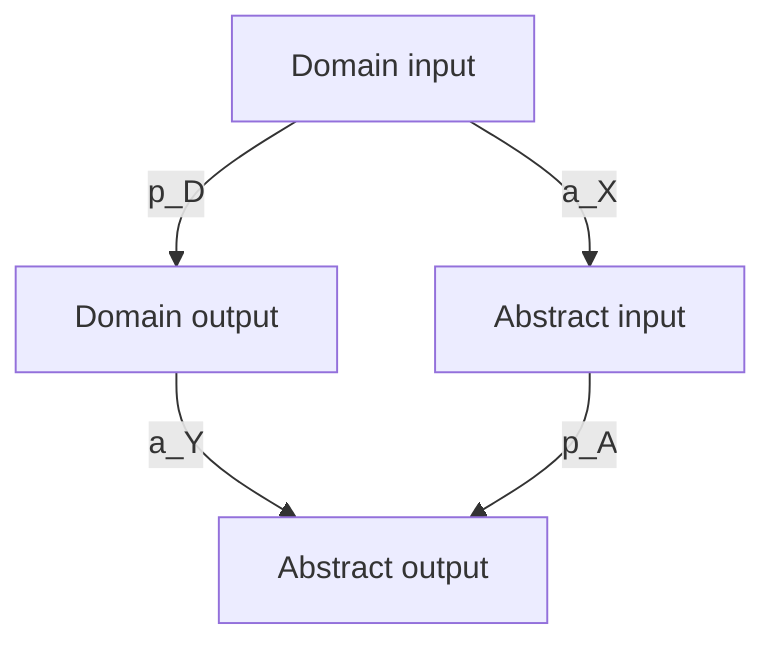

# Note 002 — Structural Correspondence

*Evolving note*

Before using one construction to suggest another, I need a clearer account of what their structural relationship is. This note distinguishes several relationships and uses two examples to explore what must be preserved.

## 1. Different kinds of correspondence

“The same structure” can refer to several different things.

| Relationship | What would need to be established |
| --- | --- |
| Exact equivalence under chosen representations | Appropriate encodings relate the constructions and preserve the declared observations |
| Sound abstraction or refinement | A specified directional guarantee relates the concrete and abstract constructions |
| Instances of a shared schema | Each construction satisfies the requirements of the same parameterized schema |
| Heuristic analogy | Similarity suggests a comparison whose applicability remains unresolved |

These relationships do not form one universal scale. A sound abstraction can intentionally lose information. A shared schema can have different parameters and different domain guarantees.

Approximate correspondence needs its own observation space, error measure, and bound. An unspecified resemblance cannot supply those.

The relationship recorded for a pair of constructions should say which of these meanings is intended.

## 2. Signatures help find candidates

A structural signature can summarize an operator:

$$
\Sigma(O)=
(T_{\mathrm{in}},T_{\mathrm{out}},
\mathrm{Relations},\mathrm{Construction},\Gamma,Q).
$$

It can record which relations are retained, what information is discarded, what new structure is introduced, and which properties are required.

Such records can guide retrieval. A state-expansion signature, for example, can direct attention to constructions that encode context and supply an observation map.

Different constructions can have matching recorded features. A signature therefore identifies a candidate correspondence to inspect. Its usefulness depends on how much structure the representation retains.

## 3. An explicit correspondence

For a deterministic domain construction and an abstract construction, let

$$
p_D:X_D\to Y_D,\qquad p_A:X_A\to Y_A,
$$

with abstraction maps

$$
a_X:X_D\to X_A,\qquad a_Y:Y_D\to Y_A.
$$

One possible compatibility condition is

$$
a_Y\circ p_D=p_A\circ a_X
$$

on the declared admissible inputs.

The two routes through the diagram produce the same abstract result.

The choice of maps matters. Constant maps to a one-element representation can make an equation of this form hold while retaining almost no information. The maps must preserve the observations needed for the intended contract and target goal.

If an abstraction loses information, this equation also does not explain how to construct a domain output from an abstract output. A target interpretation, decoder, or separate construction is still needed.

Bijective encodings that preserve the relevant structure can support an exact equivalence. Lossy maps may instead support a directional or approximate relationship.

## 4. Nondomination: a concrete shared operation

Let $S$ be finite and let $\prec$ be a strict partial order. Use $x\prec y$ to mean that $y$ dominates $x$. Define

$$
\operatorname{ND}(S,\prec)
=\{x\in S:\nexists\, y\in S:\ x\prec y\}.
$$

For criteria $f_1,\ldots,f_m$ to minimize, a familiar realization is

$$
x\prec y
\quad\Longleftrightarrow\quad
\bigl(\forall k,\ f_k(y)\le f_k(x)\bigr)
\land
\bigl(\exists k,\ f_k(y)<f_k(x)\bigr).
$$

| Structural role | Multiobjective optimization | Database selection |
| --- | --- | --- |
| Elements | Feasible candidate decisions | Rows admitted by the query |
| Dominance | Comparison under objectives | Comparison under query preferences |
| Construction | Select nondominated candidates | Select skyline rows |
| Result | Pareto set within the given candidates | Skyline query result |

This is an established connection [R11]. I use it to illustrate an explicit structural correspondence.

For a small example, minimize both coordinates:

| Element | First coordinate | Second coordinate | Nondominated? |
| --- | ---: | ---: | --- |
| $A$ | 1 | 4 | Yes |
| $B$ | 2 | 2 | Yes |
| $C$ | 3 | 3 | No: dominated by $B$ |
| $D$ | 4 | 1 | Yes |

The output is $\{A,B,D\}$. Giving the coordinates different domain meanings can leave this calculation unchanged if the same preference relation is retained.

## 5. A preservation condition and a failure case

Suppose $g:S_1\to S_2$ is a bijection that preserves and reflects dominance:

$$
x\prec_1y
\quad\Longleftrightarrow\quad
g(x)\prec_2g(y).
$$

Then

$$
g\bigl(\operatorname{ND}(S_1,\prec_1)\bigr)
=\operatorname{ND}(S_2,\prec_2).
$$

A dominator on either side corresponds to a dominator on the other side, so nondominated elements correspond as well.

Dropping a coordinate can break this property. With both coordinates minimized, let

$$
S=\{(0,1),(1,0)\},
\qquad \pi(x_1,x_2)=x_1.
$$

The two points are incomparable, so $\operatorname{ND}(S)=S$. After projection,

$$
\pi(\operatorname{ND}(S))=\{0,1\},
\qquad
\operatorname{ND}(\pi(S))=\{0\}.
$$

Projection is monotone for the weak componentwise order, but it can turn previously incomparable points into comparable ones. Nondomination is therefore not preserved by this map.

This example makes the missing condition visible. A transfer needs a relationship strong enough to preserve the particular construction and observations being used.

## 6. A broader pattern: representing sufficient context

The next comparison is more tentative. Consider a representation whose current state omits information needed for a desired next-step rule. An expanded representation can encode that information and update it explicitly.

A candidate schema would specify the encoded context, the expanded state space, its update rule, and how its observations relate to the original description.

The following constructions motivate the comparison. Their concrete guarantees must be stated separately.

### Sets of possible automaton states

For an NFA without epsilon transitions, let $Q$ be its states, $\Sigma$ its alphabet, $\delta_N:Q\times\Sigma\to 2^Q$ its transition function, $q_0$ its initial state, and $F$ its accepting states.

The subset construction uses $U\subseteq Q$ as a deterministic state:

$$
\delta_D(U,a)=\bigcup_{q\in U}\delta_N(q,a).
$$

The initial state is $\{q_0\}$, and $U$ is accepting when $U\cap F\ne\varnothing$. With epsilon transitions, epsilon closure is also required.

The set records alternatives consistent with the input prefix. The resulting DFA recognizes the same language [R12]. It may have up to $2^{|Q|}$ states; only reachable subsets need to be constructed.

### Elapsed age in a stochastic state

Consider a time-homogeneous discrete semi-Markov model in which the positive integer duration $D_i$ depends only on the current state $i$. Assume successive visits follow the specified renewal mechanism and that duration and next destination are conditionally independent given $i$.

Let $q_{ij}$ be the destination probabilities, with $q_{ii}=0$ and $\sum_{j\ne i}q_{ij}=1$. At an age with positive survival probability, define

$$
h_i(a)=\Pr(D_i=a+1\mid D_i>a).
$$

Age is zero on entry. The expanded state $(i,a)$ has transitions

$$
\begin{aligned}
\Pr((i,a)\to(i,a+1))&=1-h_i(a),\\
\Pr((i,a)\to(j,0))&=h_i(a)q_{ij},\qquad j\ne i.
\end{aligned}
$$

This is a Markov representation under the declared assumptions. Its projection $(i,a)\mapsto i$ reproduces the modeled visible process when the initial state and age distribution are matched. Semi-Markov modeling is an established subject [R15].

For a toy duration law,

$$
\Pr(D_i=1)=\tfrac14,\qquad
\Pr(D_i=2)=\tfrac12,\qquad
\Pr(D_i=3)=\tfrac14,
$$

the exit probabilities at ages zero, one, and two are $1/4$, $2/3$, and $1$. The visible state stays $i$ during the visit, while its next-step probability depends on age. One can complete this toy example with a single absorbing destination $j$.

A general semi-Markov kernel can couple duration and destination and needs the corresponding conditional probabilities. Unbounded durations can require infinitely many age states. Arbitrary empirical time series need not become Markov after adding age.

## 7. What the comparison leaves open

| Aspect | Automaton determinization | Semi-Markov age expansion |
| --- | --- | --- |
| Encoded information | Set of possible states | Current state and elapsed age |
| Desired local property | Deterministic update for each symbol | Markov next-step law |
| Observation to preserve | Accepted language | Projected stochastic process law |
| Possible cost | Exponentially many subset states | Potentially unbounded age states |

The common question is whether relevant context can be represented as an updated state. The table does not identify the complete algorithms or their guarantees with one another.

I would like to find a precise shared schema, or learn where this broad comparison must split into different families.

An explicit correspondence should help answer both why a proposed reinterpretation works and which missing condition makes a nearby reinterpretation fail.

References: [shared reading list](../references.md).

Previous: [Note 001 — Foundations](note-001-foundations.md). Next: [Note 003 — Automating Research](note-003-automating-research.md).
